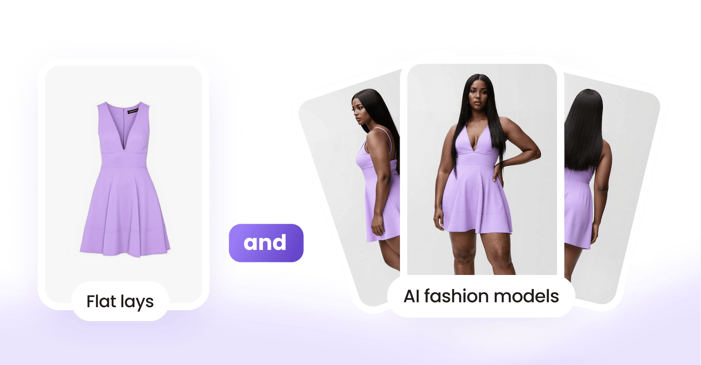

# Studio API for Fashion Product Imagery

{ width=600 }

Generate on-model and flat-lay product imagery from existing product images. AIUTA’s Studio API brings fashion content generation into your own workflow, with controls for model appearance, viewpoints, backgrounds and output settings.

[Get started](/api/getting-started.md){ .md-button .md-button--primary }
[Book a demo](https://info.aiuta.com/en-us/contact-us){ .md-button target="_blank" }

## What the Studio API does

The Studio API provides programmatic access to product imagery generation within AIUTA [Content Production](https://www.aiuta.com/aiuta-studio){:target="_blank"}. Submit product images, select the output types and configure the generation settings. Your integration tracks an asynchronous operation and retrieves the generated images for review and use in your content workflow.

## Studio API inputs

Supply product images as uploaded image identifiers or direct image URLs. You can also include optional product metadata, such as category, title and description. Specify the output types and supported settings in the generation request; consult the [reference](/api/studio/reference.md) for required fields and accepted values.

## Product imagery output types

### Flat-lay product imagery

The documented output types are `flat`, `ghost_mannequin` and `detail`, with `front` and `back` viewpoints. Use these options to generate product-only imagery for your catalog.

### On-model product imagery

On-model generation, named on-figure in the API, shows the garment on a generated model. Viewpoints include `front`, `front_angled`, `side`, `back` and `back_angled`. Pose values include `standing`, `walking`, `sitting`, `leaning`, `crouching_or_kneeling`, `in_action` and `close_up`.

## Model and background controls

Choose a published model preset or configure model attributes: gender, age group, ethnicity, skin tone, body shape, height and hair. Hair settings include color, length and style. Background options include arbitrary, transparent and reference-color settings. Set image size and padding through the supported output fields.

Retrieve the available presets through the API and use a preset in place of individual model settings. Reusing a preset reuses appearance settings; exact facial features can vary between generated images.

## Asynchronous image generation workflow

Prepare the product images, submit a generation request and track the returned operation until it completes. Retrieve the generated images on success, or inspect the error details if generation fails. Polling may require multiple requests. The reference defines supported operation states and the `online` and `offline` priority settings.

## Selective regeneration for on-model images

Regenerate selected on-figure image types using an existing operation and its configuration, rather than rerunning the entire set. The documented selective-regeneration workflow is for on-figure generation. For flat-lay imagery, submit a new generation request. The API also includes an operation to delete generated images.

## Studio API endpoints

The table summarizes the Studio API endpoints. Use the linked [API reference](/api/studio/reference.md) for request and response schemas and the [workflow](/api/studio/workflow.md) for the order of calls.

| Method | Path | What it does |
| --- | --- | --- |
| `POST` | `/uploaded_images` | Upload an input image and receive its identifier |
| `GET` | `/uploaded_images/{image_id}` | Read back an uploaded image |
| `DELETE` | `/uploaded_images/{image_id}` | Delete an uploaded image |
| `POST` | `/flat_lay_operations` | Start a flat-lay generation |
| `GET` | `/flat_lay_operations/{operation_id}` | Follow a flat-lay operation and take its results |
| `GET` | `/on_figure_model_presets` | List the published model presets |
| `POST` | `/on_figure_operations` | Start an on-figure generation |
| `GET` | `/on_figure_operations/{operation_id}` | Follow an on-figure operation and take its results |
| `POST` | `/on_figure_operations/regenerate` | Regenerate individual on-figure image types |
| `DELETE` | `/generated_images/{image_id}` | Delete a generated image |

## API access and authentication

Use the [Getting Started guide](/api/getting-started.md) to set up your [API Portal](https://developer.aiuta.com){:target="_blank"} account, subscription and credentials. Follow the documented authentication method for your integration. Consult the [Studio reference](/api/studio/reference.md) for the current base URL and endpoint requirements.

## Studio API and Content Production services

The Studio API exposes the operations listed in its reference. The broader Content Production offering may include managed creative direction, quality review and refinement; agree the service scope with AIUTA rather than assuming these services are included in every API request. Background controls on a generation request are distinct from a standalone background-removal operation.

## Integration support and service status

Explore [Content Production](https://www.aiuta.com/aiuta-studio){:target="_blank"} for the broader product imagery offering, or the [API overview](/api/index.md) to compare integration options. Visit the [status page](https://aiuta.statuspage.io){:target="_blank"} for reported service status and contact your AIUTA team for questions the documentation does not resolve.

## Start generating product imagery with the Studio API

Set up API access and follow the Studio workflow using your product images. Test the output types and settings your catalog needs, then review the results for product accuracy and presentation. Book a demo to discuss your integration requirements.

[Get started](/api/getting-started.md){ .md-button .md-button--primary }
[Book a demo](https://info.aiuta.com/en-us/contact-us){ .md-button target="_blank" }
