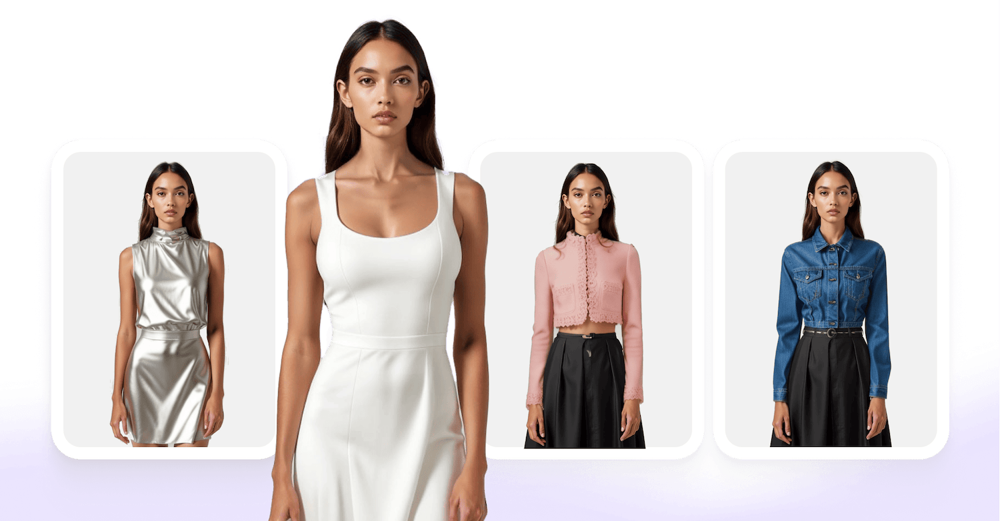

# Virtual Try-On API for Fashion

{ width=600 }

Generate virtual try-on images from a person’s photo and products in your catalog. AIUTA’s Virtual Try-On API lets you integrate garment visualization into your ecommerce experience while your team controls the interface and customer journey.

[Get started](/api/getting-started.md){ .md-button .md-button--primary }
[Book a demo](https://info.aiuta.com/en-us/contact-us){ .md-button target="_blank" }

## What the Virtual Try-On API does

The Virtual Try-On API generates an image of a person wearing a garment from your catalog. At generation time, your integration sends the person image identifier and the product identifier. Generation is asynchronous: the request creates an operation, which your integration polls to retrieve the result or error details.

## Virtual Try-On API or SDK

Use the API when you want to build and control the shopper interface around try-on generation. Use the [SDK](/sdk/index.md) when you want prebuilt interface components, including image selection, consent and results, with configuration and theming options. Review the SDK documentation for platform support and available features before choosing your integration approach.

## Virtual Try-On API inputs

The generation request requires a person image identifier and one or more catalog item identifiers. Prepare the person image before creating the operation, and use product identifiers configured in your catalog. The optional catalog field is described below.

| Parameter | What it is | Required |
| --- | --- | --- |
| `uploaded_image_id` | The image of the person. Upload one and take the id from the response, or take the id of one of the predefined models AIUTA publishes. | Required |
| `sku_id` | The item identifier your catalog already uses. This is what ties the generated image to a real product on your side. | `sku_id` or `sku_ids` |
| `sku_ids` | A list of 1 to 6 item identifiers, for an outfit try-on with several items. | `sku_id` or `sku_ids` |
| `sku_catalog_name` | Optional name of the catalog the item belongs to. | Optional |

## How the Virtual Try-On API works

The workflow has three steps. Polling may require multiple requests before generation finishes. Use the linked [workflow](/api/try-on/workflow.md) and [API reference](/api/try-on/reference.md) for endpoint paths, request bodies and response schemas.

1. __Prepare the image.__ Upload an image of the person, or retrieve the predefined models. Either route returns an object with an `id` and a `url`, and the `id` is what the next step sends.
2. __Create the operation.__ Send `uploaded_image_id` and `sku_id` (or `sku_ids` for an outfit). Include the optional `sku_catalog_name` when specifying a catalog for the item. The response carries an `operation_id`.
3. __Retrieve the result.__ Poll using the `operation_id` until the operation reaches a final state. On `SUCCESS`, read the result URLs from `generated_images` and display the images in your interface. On `FAILED`, inspect `error` to diagnose the issue before retrying.

## Prerequisites

Use the [Getting Started guide](/api/getting-started.md) to set up access through the AIUTA [API Portal](https://developer.aiuta.com){:target="_blank"} and configure authentication. The guide covers account, subscription and credential requirements. Ensure the product you want to use is available in your configured catalog before submitting a generation request.

## Visual result, not physical fit

The generated image visualizes how a garment looks on the person in the photo. It does not measure physical fit or recommend a size. Make this distinction clear in your shopper experience. The SDK provides a configurable fit disclaimer component; API integrations should include appropriate explanatory wording in their own interface.

## Integration support and service status

Virtual try-on is part of AIUTA [Shopper Experience](https://www.aiuta.com/shopper-experience){:target="_blank"}. Visit the product page to discuss your requirements, the [API overview](/api/index.md) to compare integration options, and the [status page](https://aiuta.statuspage.io){:target="_blank"} for service availability and incidents. Contact your AIUTA team for questions the documentation does not resolve.

## Start integrating the Virtual Try-On API

Set up API access, follow the workflow and test generation with your own catalog. Review the results within your intended shopper journey. Book a demo to discuss your implementation requirements with the AIUTA team.

[Get started](/api/getting-started.md){ .md-button .md-button--primary }
[Book a demo](https://info.aiuta.com/en-us/contact-us){ .md-button target="_blank" }
