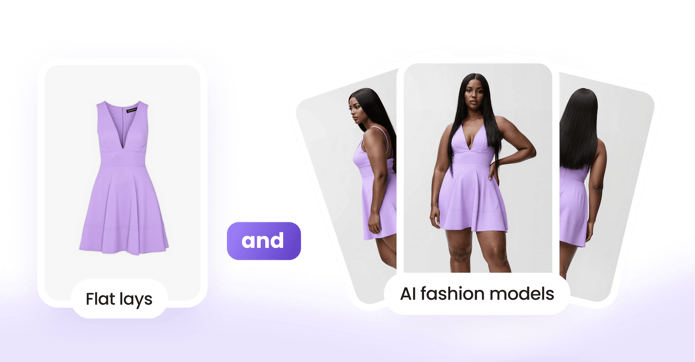

# Unified API for Virtual Try-On and Product Imagery

{ width=600 }

Access supported AIUTA capabilities through a shared API. Manage product records, configure SKU capabilities and build virtual try-on and product imagery workflows. Use the reference to match available operations to your integration requirements.

[Get started](/api/getting-started.md){ .md-button .md-button--primary }
[Book a demo](https://info.aiuta.com/en-us/contact-us){ .md-button target="_blank" }

## What the Unified API does

The Unified API provides a shared interface for supported AIUTA capabilities. For SKU-based workflows, register a product and configure the capabilities it needs, then check their preparation status before use. An ad-hoc try-on route also accepts product details inline, without prior SKU registration. Confirm the capabilities available to your account before implementation.

## SKU product records and image inputs

A SKU item stores your product identifier, images and associated attributes. Supply image URLs or identifiers of previously uploaded images using the supported input route; do not mix the two in one request. The specification permits up to twenty images for either route. Product attributes include category, title, description, brand, color, gender and age group. Consult the [reference](/api/unified/reference.md) for required fields and current limits, and the [Getting Started guide](/api/getting-started.md) to set up access.

## Capabilities declared on a SKU item

The specification declares five SKU capabilities: three boolean switches and two lists of requested image variants. The table describes the schema; a declared field does not by itself establish customer availability. Confirm access and supported behavior with AIUTA.

| Capability | How it is declared | What the reference says |
| --- | --- | --- |
| `try_on` | On or off | Virtual Try-On for this SKU item |
| `outfit_recommendations` | On or off | The SKU item may be used in recommendation flows |
| `size_and_fit` | On or off | Declared Size & Fit field; confirm supported behavior and availability with AIUTA |
| `off_figure_product_images` | List of variants | Flat-lay variants to generate, each prepared on its own |
| `on_figure_product_images` | List of variants | On-model variants to generate, each prepared on its own |

An empty image-variant list requests no images of that type. Enabling a SKU capability starts its preparation process; check its readiness state before attempting to use it.

## Capability readiness states

Readiness is tracked per SKU capability and, for product imagery, per requested variant. The states are `absent` (not enabled or requested), `preparing` (preparation in progress), `ready` (available for use), `rejected` (unusable following quality or policy checks) and `failed` (preparation failed). Check the state and any error details before invoking the capability.

## Try-on through the Unified API

The SKU-based route uses registered product identifiers with the person image. The ad-hoc route accepts product details inline without prior registration. The specification currently allows one to six items per try-on operation. This combines items in a generation request; the full workflow also includes image preparation and result retrieval. Consult the reference for current limits and predefined-model options.

See also the [Virtual Try-On API](/api/try-on/index.md).

## Outfit recommendations

The reference includes an outfit-recommendations operation for a SKU item, with an optional user identifier for personalization. Confirm that the capability is available, enabled and ready for your product. Use the reference for request fields and response behavior.

## Product imagery

Flat-lay generation runs as its own operation and is followed to a final state like any other. Image variants are requested on the SKU item rather than per call. A flat-lay variant is a layout style and a viewpoint; an on-model variant is a viewpoint and a pose. Uploaded and generated images are addressable, and both can be deleted.

See also the [Studio API](/api/studio/index.md).

## What the reference publishes

The operation summary below groups the endpoints in the specification. Use the [Unified reference](/api/unified/reference.md) for current request and response schemas, supported operations and limits.

| Group | Operations | What it covers |
| --- | --- | --- |
| `sku_items` | 6 | Create, list, read and delete SKU items; replace capabilities; replace merchandising |
| `try_on` | 6 | SKU try-on, ad-hoc try-on, their results, and the predefined and try-on model lists |
| `data` | 4 | Upload, read and delete images; delete a generated image |
| `flat_lay` | 2 | Start a flat-lay operation and read its result |
| `on_figure` | 2 | Start an on-figure operation and read its result |
| `recommendations` | 1 | Outfit recommendations for a SKU item |

## Access and authentication

Use the [Getting Started guide](/api/getting-started.md) to configure your [API Portal](https://developer.aiuta.com){:target="_blank"} account, subscription and credentials. Follow the documented authentication requirements for your integration and keep API keys out of client applications. Consult the [authentication documentation](/api/server-side-auth-component.md) for the appropriate server-side implementation.

## Generation is asynchronous

Generation requests return an operation identifier. Track that operation using its documented status endpoint and retrieve the result when generation completes. Polling can require multiple requests. Handle the states and error fields defined for the specific operation rather than assuming all AIUTA APIs have identical behavior.

## What the generated images are

Try-on generation produces a visual representation of garments on a person, while product-image generation produces new product views. The API also supports uploaded-image operations, so not every image it retrieves is generated. Explain the nature and limits of generated results in your shopper interface; a try-on image alone does not establish physical fit or a size recommendation.

## Integration support and service status

Explore [Shopper Experience](https://www.aiuta.com/shopper-experience){:target="_blank"} and [Content Production](https://www.aiuta.com/aiuta-studio){:target="_blank"} for the related commercial offerings. Confirm capability availability and service scope with your AIUTA team. Visit the [status page](https://aiuta.statuspage.io){:target="_blank"} for reported service status, and use the API reference for implementation details.

## Data handling and legal terms

Review AIUTA’s [Privacy Policy](https://aiuta.com/legal/privacy-policy.html){:target="_blank"} and [Terms of Use](https://aiuta.com/legal/terms-of-service.html){:target="_blank"} when planning your integration. Discuss security, data handling and compliance requirements with the AIUTA team.

## Start with one product

For a SKU-based workflow, register a product, enable an available capability and check that its readiness reaches `ready` before using it. For ad-hoc try-on, follow the inline-product request in the reference. Test the complete flow, including result retrieval, before connecting it to your customer experience.

[Get started](/api/getting-started.md){ .md-button .md-button--primary }
[Book a demo](https://info.aiuta.com/en-us/contact-us){ .md-button target="_blank" }
