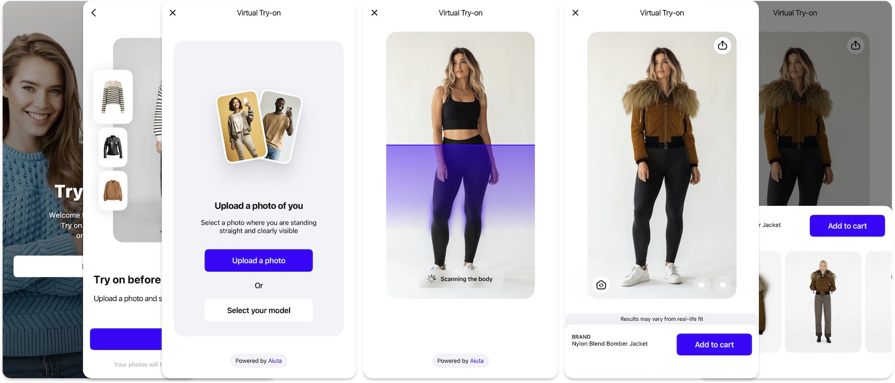

# Your app. Their next look.

Bring virtual try-on into your app with AIUTA’s SDK for Android, iOS and Flutter. A prebuilt shopper interface takes customers from choosing a photo to seeing the result, with controls to make the experience feel like your brand.

[Get started](/api/getting-started.md){ .md-button .md-button--primary }
[Book a demo](https://info.aiuta.com/en-us/contact-us){ .md-button target="_blank" }

## Virtual try-on with the shopper journey built in

The SDK brings together image selection, consent, try-on results and history, powered by AIUTA’s [Virtual Try-On API](/api/try-on/index.md). Your team can configure the interface and connect it to your shopping journey. AIUTA Studio uses separate APIs and production workflows.

## Start with the SDK or build with the API

Use the SDK for a prebuilt try-on interface you can configure. Use the [API](/api/try-on/index.md) to build your own interface and workflow. Both connect to AIUTA’s try-on technology; choose the route that fits your product and development team.

## Choose your platform

Start with the requirements below, then follow your platform’s integration guide. Check the current release requirements before implementation.



Planning a web experience? AIUTA publishes a [Web SDK](/sdk/web/index.md) quick start with limited configuration and styling support. Confirm availability and the features you need with the team.

## From setup to your first try-on

### Android

Check the Android requirements, install the SDK and configure authentication. Follow the basic usage guide to launch the try-on interface, then connect analytics. [Android guide](/sdk/android/index.md)

### iOS

Install the iOS SDK, configure authentication and run the quick test. Then tailor the interface using the available theme and feature options. [iOS guide](/sdk/ios/index.md)

### Flutter

Check the Dart and Flutter requirements, add the dependency and follow the configuration guide. Use the quick test before adapting the shopper journey. [Flutter guide](/sdk/flutter/index.md)

## Make it feel like your brand

Adjust supported colors, typography, labels and interface elements. Configure onboarding, photo selection, consent, try-on and sharing to suit your journey. Options vary by platform; the [configuration guide](/sdk/developer/index.md) shows what is available, including [feature configuration](/sdk/developer/configuration/features/index.md).

## Connect authentication

Set up credentials through the AIUTA [API Portal](https://developer.aiuta.com){:target="_blank"} and follow your platform’s authentication guide. With JWT authentication, your backend validates the request and issues a signed token for the SDK, keeping the signing secret on the server. See [Getting started](/api/getting-started.md).

## Give shoppers a clear photo journey

Configure the privacy notice and consent flow for your implementation. The SDK supports an onboarding notice or a dedicated consent page, with optional photo-protection messaging. Choose the appropriate setup for your audience and applicable requirements before launch. See AIUTA’s [Privacy Policy](https://aiuta.com/legal/privacy-policy.html){:target="_blank"} and [Terms of Use](https://aiuta.com/legal/terms-of-service.html){:target="_blank"}.

## See where shoppers engage

Connect SDK events and errors to your analytics to track try-on activity and identify friction. Link those events to commerce outcomes when measuring business impact, using a suitable comparison such as an A/B test.

## A visual preview

Virtual try-on shows how a garment looks on the person in the photo. It does not measure physical fit or recommend a size. Use the SDK’s configurable fit disclaimer to make that clear in the experience.

## Migrations and support

Check the platform migration guide before a major upgrade. Use AIUTA’s [status page](https://aiuta.statuspage.io){:target="_blank"} for service updates and contact your onboarding team for integration support. Learn more about [Shopper Experience](https://www.aiuta.com/shopper-experience){:target="_blank"}.

## Bring the first look to life

Choose your platform, connect authentication and run a test try-on. Then make the interface yours and connect analytics before launch.

[Get started](/api/getting-started.md){ .md-button .md-button--primary }
[Book a demo](https://info.aiuta.com/en-us/contact-us){ .md-button target="_blank" }
